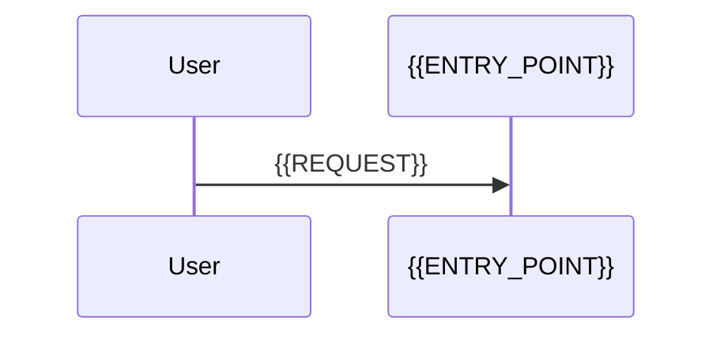

<!-- code-to-doc-artifact
{
  "schemaVersion": 1,
  "kind": "module-map",
  "scope": "{{SCOPE}}",
  "status": "draft"
}
-->
# {{TITLE}}

## Scope

{{READER_SCOPE_AND_EXCLUSIONS}}

## Modules and responsibilities

- {{MODULE}}: {{RESPONSIBILITY}} [[source:{{PATH}}#L{{START}}-L{{END}}]]

## Dependencies

```mermaid
flowchart LR
  {{CALLER}} --> {{CALLEE}}
```

- {{WHAT_THE_DIAGRAM_SHOWS}} [[source:{{PATH}}#L{{START}}-L{{END}}]]

## Data flow



- {{FLOW_STEP}} [[runtime:{{OBSERVATION_ID}}]]

## Entry points

| Entry point | Type | Evidence |
|---|---|---|
| {{URL_OR_COMMAND}} | {{HTTP_OR_BATCH}} | [[source:{{PATH}}#L{{START}}-L{{END}}]] |

## Evidence

| Claim | Evidence |
|---|---|
| {{CLAIM}} | [[source:{{PATH}}#L{{START}}-L{{END}}]] |

## Unknowns

- U-1: {{UNKNOWN}} (next read: {{NEXT_READ_OR_OBSERVATION}})
